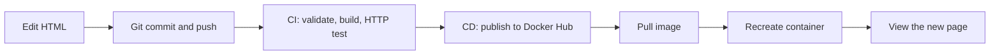

# From Code to Container

A beginner workshop about **HTML source → GitHub → CI → Docker image → Docker Hub → a running application**. Change three lines, watch the pipeline, and see why publishing a new image does not update a running container.

The stack is HTML5, embedded CSS3, official Nginx Alpine, Docker, GitHub Actions, Docker Hub, Bash, and PowerShell. No package manager, backend, database, or JavaScript dependencies. The starting page is **Version 1**, blue, with **Hello from Version 1!**



- **CI (continuous integration)** checks each change: validate the source, build an image, and test a running container.
- **CD (continuous delivery)** publishes the tested image so someone can deploy it. Deployment is manual in this workshop.
- An **image** packages the application and its runtime, like a reusable template. A **container** is an instance created from an image.
- **Docker Hub** stores images. A **tag** names a version: `latest` moves as releases arrive; `sha-a1b2c3d` identifies a commit.

## Student walkthrough — start here

Follow **Part 1** to build and run the application on your own computer. Then follow **Part 2** to download the instructor's published image from Docker Hub.

### Choose your terminal

| Your computer | Terminal to use | Helper script, if you use one later |
| --- | --- | --- |
| Windows | **PowerShell** or Windows Terminal with a PowerShell tab | `scripts/update-container.ps1` |
| Windows | **Command Prompt (CMD)** | Run the individual Docker commands, or invoke PowerShell as shown below |
| macOS (Intel or Apple Silicon) | **Terminal**, using Bash or the default Zsh | `scripts/update-container.sh` |
| Linux | **Terminal / Bash** | `scripts/update-container.sh` |

**The Git and Docker commands in steps 1–10 work unchanged in PowerShell, CMD, Bash, and Zsh.** Run one line at a time. Commands that differ by terminal have separate labeled examples. Copy only the text inside the command boxes, not the surrounding explanations.

Windows students do not need Bash for this walkthrough. If `bash` reports a WSL `/bin/bash` error, use PowerShell or CMD and the individual Docker commands instead.

### Before you start

Install [Git](https://git-scm.com/downloads) and [Docker Desktop](https://docs.docker.com/desktop/). Start Docker Desktop and wait for the engine to be running. On Windows, select **Linux containers**. On macOS, install the edition for your processor: Intel or Apple Silicon. Linux users can use Docker Engine with Buildx.

You do not need a Docker Hub account or the instructor's token to pull the **public** workshop image. Your instructor needs an account to publish it. Anonymous pulls have rate limits; an optional Docker login may help a class sharing one network.

## Part 1 — Build and run locally

### Step 1 — Check Git and Docker

**Run in your chosen terminal:**

```bash
git --version
docker version
docker info
```

**Expected:** Git prints a version, and Docker shows both a **Client** and a **Server**. If the Docker server is unavailable, start Docker Desktop before continuing.

### Step 2 — Clone the project

Open a terminal in the folder where you want to store the project.

**Run:**

```bash
git clone https://github.com/DenisaEmilia/Master-The-Stack-Workshop.git
cd Master-The-Stack-Workshop
```

`git clone` downloads the source code. `cd` moves your terminal into the project folder. Run all local build commands from this folder, where `Dockerfile` and `index.html` live. If you already cloned it, use your existing folder instead of cloning into it again.

Open `index.html` directly to see the source page in your browser. Choose **one** command for your terminal:

**Windows PowerShell:**

```powershell
Start-Process .\index.html
```

**Windows CMD:**

```bat
start "" index.html
```

**macOS Terminal (Bash or Zsh):**

```bash
open index.html
```

**Linux desktop / Bash:**

```bash
xdg-open index.html
```

This first browser tab reads the file directly. Later, use the **localhost tab** to see what the container serves.

### Step 3 — Build your local image

**Run from the project folder:**

```bash
docker build -t workshop-app:local .
```

| Command part | Meaning |
| --- | --- |
| `docker build` | Create an image using the Dockerfile |
| `-t workshop-app:local` | Name the image `workshop-app` with the tag `local` |
| `.` | Send the current folder as the build context |

Docker downloads the official Nginx base image and copies your HTML into it. The first build may take longer because Docker needs to download the base.

**Show your images:**

```bash
docker image ls
```

**Expected:** `workshop-app` with tag `local`. Building an image does **not** start a container or open the website.

### Step 4 — Start a container and open the page

**Run:**

```bash
docker run -d --name workshop-app --label com.from-code-to-container.workshop=true -p 127.0.0.1:8080:80 workshop-app:local
```

| Command part | Meaning |
| --- | --- |
| `docker run` | Create and start a new container |
| `-d` | Run it in the background; no separate window opens |
| `--name workshop-app` | Give the container a recognizable name |
| `--label com.from-code-to-container.workshop=true` | Let the optional update helpers recognize this demo safely |
| `-p 127.0.0.1:8080:80` | Send requests on your computer's local port **8080** to Nginx on container port **80** |
| `workshop-app:local` | Use the image you built in step 3 |

**Open this exact address in a browser, including `:8080`:**

```text
http://localhost:8080
```

**Expected:** the application page matching your cloned HTML, initially blue with **Version 1** and **Hello from Version 1!**. If the instructor has already changed the repository, your page will match that newer source.

**Verify the container is running:**

```bash
docker ps
docker logs workshop-app
```

Look for `workshop-app` and `127.0.0.1:8080->80/tcp`. Docker Desktop also lists it under **Containers**. Clear filters if it is hidden. If your terminal shows it but Desktop does not, `docker context show` helps identify which Docker engine your terminal is using.

### Step 5 — Stop and restart the same container

**Stop the demo:**

```bash
docker stop workshop-app
```

Refresh the localhost tab: the server is now unavailable. A browser may keep an old page visible until you reload.

**Show all containers, including stopped ones:**

```bash
docker ps -a
```

**Start the same container again:**

```bash
docker start workshop-app
```

Refresh the browser: the page returns. `docker start` reuses an existing container; `docker run` creates a new one.

### Step 6 — Edit the page, rebuild, and replace the container

Open `index.html` in a text editor. Change the visible message inside `<p id="app-message">` to **Hello from my local container!** and save. Keep the heading and element IDs unchanged.

Refresh **the localhost tab**, not the source-file tab. **The container still serves the old message.** Its HTML was copied into the image during the previous build.

**Rebuild the image with your change:**

```bash
docker build -t workshop-app:local .
```

Refresh again: **the running container still shows the old message**. A rebuild does not replace an existing container.

**Replace only your demo container:**

```bash
docker rm -f workshop-app
docker run -d --name workshop-app --label com.from-code-to-container.workshop=true -p 127.0.0.1:8080:80 workshop-app:local
```

`docker rm -f` stops and removes this named container. It keeps your source files and images. The next `docker run` creates a container from the rebuilt image.

**Expected:** refresh the browser and see **Hello from my local container!** You do not need to commit or push this local exercise to the instructor's repository.

## Part 2 — Run the published Docker Hub image

### Step 7 — Watch the instructor publish

The instructor changes the HTML, commits it, and pushes to GitHub. Watch **Actions → From Code to Container**:

1. **CI** validates the files, builds an image, and tests a real HTTP response.
2. **CD** publishes the image after CI succeeds.
3. **Docker Hub** shows `latest` and a commit-specific `sha-…` tag.

Ask the instructor for the full public image address, for example `yourname/workshop-app:latest`. **Replace `yourname` in every command below with the instructor's actual Docker Hub username, not your own username.** It identifies who published the image; it is not a login credential.

The published image contains the instructor's HTML. Your uncommitted local edits are not included in it. Keep your demo running during this explanation: publishing does not change it automatically.

### Step 8 — Pull the public image and replace your local demo

These commands work in **PowerShell, CMD, Bash, or Zsh, from any folder**. Students only following Part 2 do not need Git, a source checkout, or a Docker Hub account.

**Download the instructor's image first:**

```bash
docker pull yourname/workshop-app:latest
```

Wait for the pull to succeed before replacing your demo. “Image is up to date” is also a successful result.

**If you followed Part 1, remove your local demo container:**

```bash
docker rm -f workshop-app
```

If you skipped Part 1 and have no `workshop-app` container, skip that removal command. If the name already belongs to an unfamiliar container, inspect it before removing anything.

**Start a container from the downloaded image:**

```bash
docker run -d --name workshop-app --label com.from-code-to-container.workshop=true -p 127.0.0.1:8080:80 yourname/workshop-app:latest
```

**Open or refresh:**

```text
http://localhost:8080
```

**Expected:** the instructor's published page. You are running your own container from their public image. No source build happens in this step.

### Step 9 — Update after the instructor publishes Version 2

Leave your published Version 1 container running while the instructor changes the version badge, message, and color, then publishes Version 2. Refresh: **Version 1 remains**.

**Pull the new image:**

```bash
docker pull yourname/workshop-app:latest
```

Refresh and pause here: **still Version 1**. Pulling downloads the new image but does not replace the running container.

**Recreate the demo using the new image:**

```bash
docker rm -f workshop-app
docker run -d --name workshop-app --label com.from-code-to-container.workshop=true -p 127.0.0.1:8080:80 yourname/workshop-app:latest
```

**Expected:** refresh and see **Version 2**, green, with **Hello from Version 2! My pipeline works!** Hard-refresh if your browser cached the previous page.

**Remember: build creates an image; publish uploads it; pull downloads it; recreating the container deploys it.**

### Step 10 — Clean up after class

**Stop and remove your demo:**

```bash
docker rm -f workshop-app
```

**Verify:**

```bash
docker ps -a
```

`workshop-app` should no longer appear. Your downloaded images and source code remain available for another session. Leave unrelated containers and images alone.

## Optional — Run the application checks

With the demo running and your terminal in the source folder, choose your terminal below.

**macOS/Linux Bash, or Windows Git Bash with Bash installed:**

```bash
bash scripts/validate.sh
bash scripts/smoke-test.sh http://localhost:8080
```

**Windows PowerShell:**

```powershell
$page = Invoke-WebRequest http://localhost:8080 -UseBasicParsing
$page.StatusCode
$page.Content -match '<h1>From Code to Container</h1>'
```

Expect `200` and `True`.

**Windows CMD:**

```bat
curl.exe --fail http://localhost:8080
```

Expect the HTML, including `<h1>From Code to Container</h1>`. These optional checks do not replace the workflow's automated checks.

## Configure Docker Hub publishing (instructor, once)

**Instructor setup only.** Students pulling your public image can skip this section. Keep the token in GitHub's environment secrets; a public repository does not make the secret value public.

1. Create or sign in to an account at [Docker Hub](https://hub.docker.com/). Use your **Docker ID / username**, not your email or display name.
2. Choose **Repositories → Create repository**, select your personal namespace, name it **workshop-app**, and choose **Public** so students can pull without accounts.
3. Open Docker account settings at [Docker Home](https://app.docker.com/) → **Personal access tokens → Generate new token** (some menus place this under security). Give it a workshop description, an appropriate expiration, and **Read & Write** permissions; Delete is unnecessary. Copy it once and keep it secure. See [Docker's access-token guide](https://docs.docker.com/security/access-tokens/).
4. In your **GitHub repository**, open **Settings → Environments → test**. Create the environment named `test` if it does not exist. The publishing job selects it with `environment: test`; the CI job does not access this environment.
5. Under **Environment variables**, add **DOCKERHUB_USERNAME** with your lowercase Docker Hub username.
6. Under **Environment secrets**, add **DOCKERHUB_TOKEN** with the access token. Never put it in HTML, YAML, a shell command, a commit, or a screenshot. These are **GitHub Actions** settings, not cloud development environment variables. Existing repository-level values can also be used; a value in `test` takes precedence over the same name at repository level. If `test` requires approvals or restricts branches, publishing waits for approval or must satisfy those rules. Allow `main` for this workshop.
7. Enable Actions if necessary (forks may show **Actions → I understand my workflows, go ahead and enable them**). Commit the project on a branch and merge a pull request into `main`, or push your prepared `main` branch if repository rules permit:

   ```text
   git switch main
   git add .
   git commit -m "Add From Code to Container workshop"
   git push origin main
   ```

   Skip `git add` and `git commit` if the project is already committed. Do not force-push around branch protection.
8. Open **Actions → From Code to Container**, select the run, and watch **CI — Validate, build, and test**, then **CD — Publish to Docker Hub**. The successful summary lists the published image tags.
9. In Docker Hub, open **yourname/workshop-app → Tags**. Verify **latest** and **sha-xxxxxxx**. Copy the exact SHA tag from the Actions summary.

If credentials are missing or incorrect, CI can pass while CD fails. Correct the GitHub variable/secret, then rerun on `main`. This project includes no credential values; publication is confirmed only by a successful real run and registry tags.

## Pipeline behavior

See [.github/workflows/ci-cd.yml](.github/workflows/ci-cd.yml).

| Event | CI | Publish |
| --- | --- | --- |
| Pull request targeting `main`, including forks | Validate, build, HTTP test | Never |
| Push to `main` | Validate, build, HTTP test | After CI passes |
| Actions → Run workflow → branch `main` | Validate, build, HTTP test | After CI passes |
| Manual run on another branch | Validate, build, HTTP test | Never |

CI starts a real Nginx container, retries HTTP with timeouts, and verifies the heading and a numbered version marker. Missing files, build errors, and invalid HTTP responses fail the job. Cleanup runs even after failure. Tests accept Version 2 so the exercise keeps passing.

CD depends on CI, checks the branch/event, logs into Docker Hub, and rebuilds the same commit for **linux/amd64 and linux/arm64** using Buildx/QEMU. Docker selects the matching platform on pull. GitHub-hosted Ubuntu provides Docker; Docker Desktop is for student computers. GitHub permissions are read-only, checkout credentials are not retained, and only CD uses the Docker Hub secret. Runs are serialized per branch to reduce overlapping publication of `latest`.

Current supported official action major versions are used. Major action tags and `nginx:stable-alpine` follow upstream updates; pin reviewed action SHAs and image digests if identical builds are required. Treat commit tags as immutable workshop versions, but remember registry tags are technically movable unless Docker Hub immutability is configured. Rerunning the same source after a base-image update can change image bytes. Record a digest when exact artifact identity matters.

## Optional — Update using the helper scripts

Learn the individual pull/run commands in [Part 2](#part-2--run-the-published-docker-hub-image) first. These helpers combine pulling, stopping/removing the recognized demo, creating a new container, and checking HTTP. They require the source checkout: run them from `Master-The-Stack-Workshop`. Replace `yourname` with the instructor's Docker Hub username.

**macOS/Linux Bash, or macOS Zsh with Bash available:**

```bash
bash scripts/update-container.sh yourname
bash scripts/update-container.sh yourname/workshop-app sha-a1b2c3d
# Optional default for this terminal:
export DOCKERHUB_USERNAME=yourname
bash scripts/update-container.sh
```

**Windows PowerShell 5.1+ or PowerShell 7:**

```powershell
.\scripts\update-container.ps1 -Image yourname
.\scripts\update-container.ps1 -Image yourname/workshop-app -Tag sha-a1b2c3d
# Optional default for this terminal:
$env:DOCKERHUB_USERNAME = 'yourname'
.\scripts\update-container.ps1
```

**Windows Command Prompt (CMD), invoking the PowerShell helper:**

```bat
powershell.exe -NoProfile -File .\scripts\update-container.ps1 -Image yourname
```

To choose an older published version in CMD, use the actual tag supplied by the instructor:

```bat
powershell.exe -NoProfile -File .\scripts\update-container.ps1 -Image yourname -Tag sha-a1b2c3d
```

If execution policy blocks a reviewed local script, follow school policy. Where permitted, `Set-ExecutionPolicy -Scope Process -ExecutionPolicy RemoteSigned` affects only the current terminal. Use `Unblock-File .\scripts\update-container.ps1` after reviewing a downloaded script. Individual Docker commands require no policy change.

Helpers accept a username or **untagged** image, plus a separate tag (default `latest`). They pull before replacement, manage only the labeled `workshop-app`, bind localhost port 8080, check HTTP, and never remove images. Rerunning recreates the same selected version. Startup failures report errors; automatic rollback is not provided.

## Version 1 → Version 2

See [WORKSHOP.md](WORKSHOP.md) for the full instructor sequence. Find the three `WORKSHOP EDIT` comments in `index.html`:

| Edit | Version 1 | Version 2 |
| --- | --- | --- |
| CSS `--primary` | `#2563eb` (blue) | `#15803d` (green) |
| `id="app-version"` | `Version 1` | `Version 2` |
| `id="app-message"` | `Hello from Version 1!` | `Hello from Version 2! My pipeline works!` |

Commit and push to `main` or merge a PR. Wait for CI and CD. Refresh the old container's page: **Version 1 remains**. Pull the new image: **still Version 1**. Recreate the container: **Version 2**, green. No API, auto-refresh, volume mount, or external content updates the HTML inside an existing image.

Compare two actual commit tags from the Actions summaries, replacing the placeholders:

```text
docker run -d --name workshop-v1 -p 127.0.0.1:8081:80 yourname/workshop-app:sha-OLDHASH
docker run -d --name workshop-v2 -p 127.0.0.1:8082:80 yourname/workshop-app:sha-NEWHASH
```

Visit ports 8081 and 8082. Cleanup only these demos: `docker rm -f workshop-v1 workshop-v2`.

## Troubleshooting

| Symptom | What to check |
| --- | --- |
| Cannot connect to Docker daemon | Start Docker Desktop and wait for the engine; select Linux containers on Windows. |
| WSL error: `execvpe(/bin/bash) failed: No such file or directory` | Windows tried to use a WSL installation without Bash. Use PowerShell/CMD for the individual Docker commands, or the PowerShell helper. Bash is not needed for the main student walkthrough. |
| Port 8080 is allocated | Use `docker ps` to identify the owner. Stop only your demo, or use another host port in a manual command. |
| Name already in use / helper refuses replacement | Inspect `docker inspect workshop-app`. The helper requires the workshop label. Remove or rename an older demo yourself only after identifying it. |
| Pull access denied / repository not found | Replace `yourname`, create a Public `workshop-app` repository, and confirm CD succeeded and the tag exists. |
| Docker Hub unauthorized in Actions | In the `test` environment, username must be an environment **variable**, token an environment **secret** with Write permission. Check expiry and namespace. |
| No Actions run or Run workflow button | Enable Actions, put the workflow on `main`, and check repository Actions policies and branch filters. PRs never publish. |
| Red CI | Read the first failing step, build output, and container logs. CI failure intentionally blocks CD. |
| Green CI, red CD | Registry configuration can fail independently of application tests. Read the error and correct GitHub settings. |
| Old page after publishing/pulling | Recreate the container; inspect its image. Hard-refresh if cached. Use the localhost tab and avoid mounting source over the image. |
| Nothing opens after `docker run -d` | Background containers do not open windows. Open `http://localhost:8080` yourself; verify the container with `docker ps`. |
| `docker ps` shows the demo but Desktop does not | Clear Desktop's Containers filters and run `docker context show`. Your terminal may be using a different Docker engine. |
| No matching platform manifest | Use Linux containers and the multi-platform published image, rather than an AMD64-only manual push. |
| Pull rate limit / network denial | Stagger classroom pulls, optionally sign in, and check school proxy/firewall policy. Keep TLS verification enabled. |
| No Bash on Windows | Use PowerShell or individual Docker commands; local Bash checks can run in Git Bash/WSL. CI includes Bash. |

## Files

```text
.github/workflows/ci-cd.yml    CI, then conditional Docker Hub delivery
scripts/validate.sh           Required files and HTML markers
scripts/smoke-test.sh         Retrying HTTP smoke test
scripts/update-container.sh  Bash deployment helper
scripts/update-container.ps1 PowerShell deployment helper
index.html                   Entire application including CSS
Dockerfile                   Official Nginx + copied HTML
.dockerignore                Minimal build context
WORKSHOP.md                  Instructor phases and exercises
```
