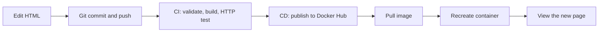

# From Code to Container

A beginner workshop about **HTML source → GitHub → CI → Docker image → Docker Hub → a running application**. Change three lines, watch the pipeline, and see why publishing a new image does not update a running container.

The stack is HTML5, embedded CSS3, official Nginx Alpine, Docker, GitHub Actions, Docker Hub, Bash, and PowerShell. No package manager, backend, database, or JavaScript dependencies. The starting page is **Version 1**, blue, with **Hello from Version 1!**



- **CI (continuous integration)** checks each change: validate the source, build an image, and test a running container.
- **CD (continuous delivery)** publishes the tested image so someone can deploy it. Deployment is manual in this workshop.
- An **image** packages the application and its runtime, like a reusable template. A **container** is an instance created from an image.
- **Docker Hub** stores images. A **tag** names a version: `latest` moves as releases arrive; `sha-a1b2c3d` identifies a commit.

## Prerequisites

Install [Git](https://git-scm.com/downloads) and [Docker Desktop](https://docs.docker.com/desktop/), then start Docker Desktop and wait for its engine. Windows users must select **Linux containers**; the WSL 2 backend is suitable. Install the Intel or Apple Silicon edition on macOS as appropriate. Linux users can use Docker Engine with Buildx.

Verify in PowerShell (Windows) or Terminal (macOS/Linux):

```text
git --version
docker version
docker info
```

The Docker server section must be present. Clone your workshop repository and change into it. For this upstream repository:

```text
git clone https://github.com/DenisaEmilia/Master-The-Stack-Workshop.git
cd Master-The-Stack-Workshop
```

Students who only run the public image need Docker, no source checkout or Docker Hub account. Anonymous pulls have rate limits; optional login can help a classroom sharing one IP. The instructor needs a GitHub repository they can push to and a Docker Hub account for publishing.

## Build and run locally

Open `index.html` directly in a browser to inspect the page. Then run these individual commands from the repository root, in either Bash or PowerShell:

```text
docker build -t workshop-app:local .
docker run -d --name workshop-app --label com.from-code-to-container.workshop=true -p 127.0.0.1:8080:80 workshop-app:local
```

Open `http://localhost:8080`. Expect the blue Version 1 page. **Container port 80** maps to **computer port 8080**. Binding to `127.0.0.1` keeps the demo on your computer. The label lets the update scripts identify their demo safely.

```text
docker image ls
docker ps
docker ps -a
docker logs workshop-app
docker inspect workshop-app
```

Run the CI checks in Bash (Terminal, Git Bash, or WSL):

```bash
bash scripts/validate.sh
bash scripts/smoke-test.sh http://localhost:8080
```

Or check HTTP in PowerShell:

```powershell
$page = Invoke-WebRequest http://localhost:8080 -UseBasicParsing
$page.StatusCode
$page.Content -match '<h1>From Code to Container</h1>'
```

Expect `200` and `True`. Cleanup:

```text
docker stop workshop-app
docker rm workshop-app
```

## Configure Docker Hub publishing (instructor, once)

1. Create or sign in to an account at [Docker Hub](https://hub.docker.com/). Use your **Docker ID / username**, not your email or display name.
2. Choose **Repositories → Create repository**, select your personal namespace, name it **workshop-app**, and choose **Public** so students can pull without accounts.
3. Open Docker account settings at [Docker Home](https://app.docker.com/) → **Personal access tokens → Generate new token** (some menus place this under security). Give it a workshop description, an appropriate expiration, and **Read & Write** permissions; Delete is unnecessary. Copy it once and keep it secure. See [Docker's access-token guide](https://docs.docker.com/security/access-tokens/).
4. In your **GitHub repository**, open **Settings → Secrets and variables → Actions**.
5. Under **Variables**, add a repository variable named **DOCKERHUB_USERNAME** with your lowercase Docker Hub username.
6. Under **Secrets**, add a repository secret named **DOCKERHUB_TOKEN** with the access token. Never put it in HTML, YAML, a shell command, a commit, or a screenshot. These are **GitHub Actions** settings, not cloud development environment variables.
7. Enable Actions if necessary (forks may show **Actions → I understand my workflows, go ahead and enable them**). Commit the project on a branch and merge a pull request into `main`, or push your prepared `main` branch if repository rules permit:

   ```text
   git switch main
   git add .
   git commit -m "Add From Code to Container workshop"
   git push origin main
   ```

   Skip `git add` and `git commit` if the project is already committed. Do not force-push around branch protection.
8. Open **Actions → From Code to Container**, select the run, and watch **CI — Validate, build, and test**, then **CD — Publish to Docker Hub**. The successful summary lists the published image tags.
9. In Docker Hub, open **yourname/workshop-app → Tags**. Verify **latest** and **sha-xxxxxxx**. Copy the exact SHA tag from the Actions summary.

If credentials are missing or incorrect, CI can pass while CD fails. Correct the GitHub variable/secret, then rerun on `main`. This project includes no credential values; publication is confirmed only by a successful real run and registry tags.

## Pipeline behavior

See [.github/workflows/ci-cd.yml](.github/workflows/ci-cd.yml).

| Event | CI | Publish |
| --- | --- | --- |
| Pull request targeting `main`, including forks | Validate, build, HTTP test | Never |
| Push to `main` | Validate, build, HTTP test | After CI passes |
| Actions → Run workflow → branch `main` | Validate, build, HTTP test | After CI passes |
| Manual run on another branch | Validate, build, HTTP test | Never |

CI starts a real Nginx container, retries HTTP with timeouts, and verifies the heading and a numbered version marker. Missing files, build errors, and invalid HTTP responses fail the job. Cleanup runs even after failure. Tests accept Version 2 so the exercise keeps passing.

CD depends on CI, checks the branch/event, logs into Docker Hub, and rebuilds the same commit for **linux/amd64 and linux/arm64** using Buildx/QEMU. Docker selects the matching platform on pull. GitHub-hosted Ubuntu provides Docker; Docker Desktop is for student computers. GitHub permissions are read-only, checkout credentials are not retained, and only CD uses the Docker Hub secret. Runs are serialized per branch to reduce overlapping publication of `latest`.

Current supported official action major versions are used. Major action tags and `nginx:stable-alpine` follow upstream updates; pin reviewed action SHAs and image digests if identical builds are required. Treat commit tags as immutable workshop versions, but remember registry tags are technically movable unless Docker Hub immutability is configured. Rerunning the same source after a base-image update can change image bytes. Record a digest when exact artifact identity matters.

## Pull and run a public image

Replace **yourname** with the instructor's Docker Hub username. No source checkout or Docker Hub login is required for a public image:

```text
docker pull yourname/workshop-app:latest
docker run -d --name workshop-app --label com.from-code-to-container.workshop=true -p 127.0.0.1:8080:80 yourname/workshop-app:latest
```

If `workshop-app` already exists, inspect it and stop/remove that demo first. Never remove an unknown container to resolve a name collision. Visit `http://localhost:8080`.

Update manually after publishing:

```text
docker pull yourname/workshop-app:latest
docker stop workshop-app
docker rm workshop-app
docker run -d --name workshop-app --label com.from-code-to-container.workshop=true -p 127.0.0.1:8080:80 yourname/workshop-app:latest
```

Pull successfully **before** stopping the old demo. Pulling does not update a running container.

Or use the helpers from a source checkout. macOS/Linux Bash:

```bash
bash scripts/update-container.sh yourname
bash scripts/update-container.sh yourname/workshop-app sha-a1b2c3d
# Optional default for this terminal:
export DOCKERHUB_USERNAME=yourname
bash scripts/update-container.sh
```

Windows PowerShell 5.1+ or PowerShell 7:

```powershell
.\scripts\update-container.ps1 -Image yourname
.\scripts\update-container.ps1 -Image yourname/workshop-app -Tag sha-a1b2c3d
# Optional default for this terminal:
$env:DOCKERHUB_USERNAME = 'yourname'
.\scripts\update-container.ps1
```

If execution policy blocks a reviewed local script, follow school policy. Where permitted, `Set-ExecutionPolicy -Scope Process -ExecutionPolicy RemoteSigned` affects only the current terminal. Use `Unblock-File .\scripts\update-container.ps1` after reviewing a downloaded script. Individual Docker commands require no policy change.

Helpers accept a username or **untagged** image, plus a separate tag (default `latest`). They pull before replacement, manage only the labeled `workshop-app`, bind localhost port 8080, check HTTP, and never remove images. Rerunning recreates the same selected version. Startup failures report errors; automatic rollback is not provided.

## Version 1 → Version 2

See [WORKSHOP.md](WORKSHOP.md) for the full instructor sequence. Find the three `WORKSHOP EDIT` comments in `index.html`:

| Edit | Version 1 | Version 2 |
| --- | --- | --- |
| CSS `--primary` | `#2563eb` (blue) | `#15803d` (green) |
| `id="app-version"` | `Version 1` | `Version 2` |
| `id="app-message"` | `Hello from Version 1!` | `Hello from Version 2! My pipeline works!` |

Commit and push to `main` or merge a PR. Wait for CI and CD. Refresh the old container's page: **Version 1 remains**. Pull the new image: **still Version 1**. Recreate the container: **Version 2**, green. No API, auto-refresh, volume mount, or external content updates the HTML inside an existing image.

Compare two actual commit tags from the Actions summaries, replacing the placeholders:

```text
docker run -d --name workshop-v1 -p 127.0.0.1:8081:80 yourname/workshop-app:sha-OLDHASH
docker run -d --name workshop-v2 -p 127.0.0.1:8082:80 yourname/workshop-app:sha-NEWHASH
```

Visit ports 8081 and 8082. Cleanup only these demos: `docker rm -f workshop-v1 workshop-v2`.

## Troubleshooting

| Symptom | What to check |
| --- | --- |
| Cannot connect to Docker daemon | Start Docker Desktop and wait for the engine; select Linux containers on Windows. |
| Port 8080 is allocated | Use `docker ps` to identify the owner. Stop only your demo, or use another host port in a manual command. |
| Name already in use / helper refuses replacement | Inspect `docker inspect workshop-app`. The helper requires the workshop label. Remove or rename an older demo yourself only after identifying it. |
| Pull access denied / repository not found | Replace `yourname`, create a Public `workshop-app` repository, and confirm CD succeeded and the tag exists. |
| Docker Hub unauthorized in Actions | Username must be a repository **variable**, token a repository **secret** with Write permission. Check expiry and namespace. |
| No Actions run or Run workflow button | Enable Actions, put the workflow on `main`, and check repository Actions policies and branch filters. PRs never publish. |
| Red CI | Read the first failing step, build output, and container logs. CI failure intentionally blocks CD. |
| Green CI, red CD | Registry configuration can fail independently of application tests. Read the error and correct GitHub settings. |
| Old page after publishing/pulling | Recreate the container; inspect its image. Hard-refresh if cached. Use the localhost tab and avoid mounting source over the image. |
| No matching platform manifest | Use Linux containers and the multi-platform published image, rather than an AMD64-only manual push. |
| Pull rate limit / network denial | Stagger classroom pulls, optionally sign in, and check school proxy/firewall policy. Keep TLS verification enabled. |
| No Bash on Windows | Use PowerShell or individual Docker commands; local Bash checks can run in Git Bash/WSL. CI includes Bash. |

## Files

```text
.github/workflows/ci-cd.yml    CI, then conditional Docker Hub delivery
scripts/validate.sh           Required files and HTML markers
scripts/smoke-test.sh         Retrying HTTP smoke test
scripts/update-container.sh  Bash deployment helper
scripts/update-container.ps1 PowerShell deployment helper
index.html                   Entire application including CSS
Dockerfile                   Official Nginx + copied HTML
.dockerignore                Minimal build context
WORKSHOP.md                  Instructor phases and exercises
```
